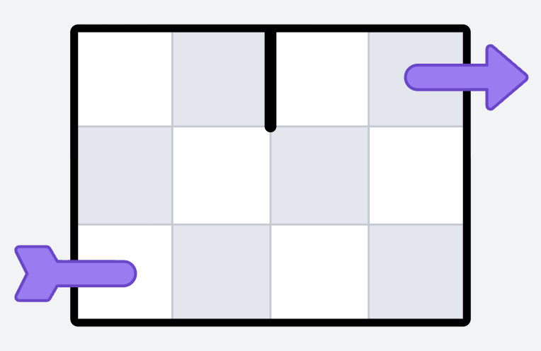

# BendyArrows

Bend the arrow through every tile of the grid, from its tail to its head.

**Play it at [https://jacob.moorman.me/bendy-arrows/](https://jacob.moorman.me/bendy-arrows/).**



## How to Play

Find a path from the arrow's tail to its head that visits every open tile once. It can't cross walls, enter black tiles, or run into itself.

- **Classic:** draw lines anywhere, in any order.
- **One-Shot:** draw one continuous stroke starting at the tail.

Draw back over lines or tap them to erase. Tap a border to mark it with an X where the path can't go.

## Feature Highlights

- 100+ levels
- Progress saved in the browser
- Shareable links
- Touch-first, keyboard-accessible

## Development

From the repo directory, with an even release of Node 22.12+:

```sh
npm install
npm run dev          # serves localhost:5173
npm run dev:phone    # the same, open to phones on your network
npm test
npm run build        # to dist/
```

## Deployment

Every push to `main` deploys to GitHub Pages through `.github/workflows/deploy.yml`, if the tests pass.

## License

The code is under the [MIT License](LICENSE). The icons are from [Lucide](https://lucide.dev) under their own license; see [THIRD_PARTY_NOTICES.md](THIRD_PARTY_NOTICES.md).